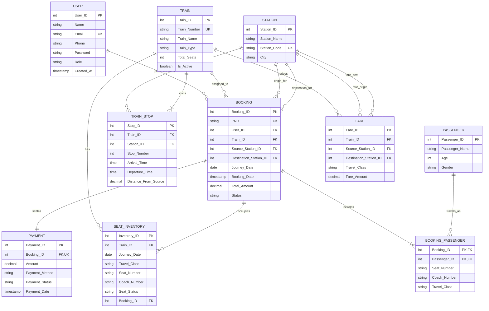

# RailConnect – Railway Reservation Management System
## College DBMS Mini-Project | Relational Database Management System

---

## 1. Project Overview & Introduction

**RailConnect** is a comprehensive, production-grade Railway Reservation Management System engineered as a college-level Database Management System (DBMS) mini-project. The application implements practical concepts of relational database design, Boyce-Codd & Third Normal Form (3NF) normalization, ACID transaction processing, multi-table relational joins, aggregate analytical queries, and role-based access control.

Modeled on real-world Indian Railways operations, the system supports two distinct roles:
1. **Passenger / User**: Search trains by route order, check real-time seat inventory by coach and travel class, book tickets for multiple passengers with atomic PNR generation, simulate digital payment processing, download official e-tickets as PDF, track live PNR reservation status, and cancel bookings with automated seat release and refunds.
2. **Administrator**: Manage train catalogs, configure stations and official IR codes, schedule route stops and distances, review system-wide booking ledgers, audit customer accounts, and monitor train-wise and daily revenue analytics.
3. **Academic DBMS Lab**: An interactive SQL terminal and pre-compiled query executor demonstrating 17+ academic queries across all fundamental SQL operations.

---

## 2. Technology Stack

- **Frontend**: React 19 SPA, TypeScript, Tailwind CSS v4, Lucide React icons, Motion animations, jsPDF for electronic ticket generation, Canvas Confetti.
- **Backend**: Node.js, Express, REST API architecture, BCrypt password hashing, session-based authentication.
- **Database Engine**: Relational MySQL 8.0 DDL compatibility (`database/RailwayDB.sql`), WebAssembly in-process relational SQL engine with full ACID transaction guarantees and persistent disk storage (`data/railway.sqlite`).
- **Database Export Files**:
  - `database/RailwayDB.sql`: Full MySQL 8.0 schema creation, tables, foreign keys, unique constraints, check constraints, views, triggers, and stored procedures.
  - `database/seed.sql`: Synthetic Indian Railways dataset with 18 stations, 10 trains, stops, fares, users, bookings, and passengers.
  - `database/queries.sql`: 17+ academic DBMS query demonstrations with SQL comments.

---

## 3. Entity-Relationship (ER) Diagram



---

## 4. Relational Schema & 3NF Normalization

### 1NF (First Normal Form)
- **Criterion**: All attributes contain atomic, indivisible values. No multi-valued attributes or repeating groups.
- **Implementation**: Instead of storing comma-separated passenger names or seat numbers inside the `Booking` table, a dedicated `Booking_Passenger` associative entity connects `Booking` to individual `Passenger` rows.

### 2NF (Second Normal Form)
- **Criterion**: In 1NF, every non-prime attribute must be fully functionally dependent on the entire composite primary key (no partial key dependencies).
- **Implementation**: In `Booking_Passenger` with composite primary key `(Booking_ID, Passenger_ID)`, passenger demographic attributes (`Passenger_Name`, `Age`, `Gender`) are dependent solely on `Passenger_ID`. They are moved to the independent `Passenger` relation. Only the relationship attributes (`Seat_Number`, `Coach_Number`, `Travel_Class`) reside in `Booking_Passenger`.

### 3NF (Third Normal Form)
- **Criterion**: In 2NF, no non-prime attribute is transitively dependent on the primary key ($X \rightarrow Y$ and $Y \rightarrow Z$).
- **Implementation**:
  - Station metadata (`Station_Name`, `Station_Code`, `City`) is stored once in `Station`. Bookings refer to `Station_ID`, eliminating transitive duplication.
  - Payment records are decoupled into `Payment` referencing `Booking_ID` uniquely.
  - Seat availability is abstracted in `Seat_Inventory`, preventing transitive calculation overhead.

---

## 5. ACID Transaction Processing

### Booking Transaction Workflow:
1. **Seat Availability Check**: Evaluates available records in `Seat_Inventory` matching `Train_ID`, `Journey_Date`, and `Travel_Class`.
2. **Locking & Verification**: Verifies sufficient seat allocation slots for requested passenger count.
3. **Master Record Creation**: Generates unique 10-digit PNR (e.g., `842-1948291`) and inserts into `Booking`.
4. **Demographic Storage**: Inserts individual passenger records into `Passenger`.
5. **Seat Mapping**: Maps coach and seat numbers in `Booking_Passenger`.
6. **Inventory Mutation**: Transitions `Seat_Inventory` status from `Available` to `Booked` with `Booking_ID` reference.
7. **Payment Recording**: Inserts successful simulated payment ledger in `Payment`.
8. **Atomicity Guarantee**: If any step encounters an error or seat contention, `ROLLBACK` reverts all steps; otherwise, `COMMIT` finalizes changes.

### Cancellation Transaction Workflow:
1. Validates that the reservation status is `Confirmed` (preventing double-cancellation anomalies).
2. Updates `Booking.Status` to `Cancelled`.
3. Releases allocated seats in `Seat_Inventory` back to `Available` (`Booking_ID = NULL`).
4. Updates `Payment.Payment_Status` to `Refunded` with simulated credit calculation.
5. Commits atomically.

---

## 6. Pre-seeded Synthetic Indian Railways Dataset

- **18 Stations**: Mumbai Central (MMCT), Pune Junction (PUNE), Kalyan (KYN), Thane (TNA), Nagpur (NGP), Nashik Road (NK), Ahmedabad (ADI), Surat (ST), Bhopal (BPL), New Delhi (NDLS), Jaipur (JP), Chennai Central (MAS), Bengaluru City (SBC), Hyderabad (HYB), Howrah (HWH), Vadodara (BRC), Kota (KOTA), Agra Cantt (AGC).
- **10 Signature Trains**:
  1. `22221`: Mumbai CSMT - Hazrat Nizamuddin Rajdhani
  2. `20901`: Mumbai Central - Gandhinagar Vande Bharat
  3. `12951`: Mumbai Central - New Delhi Tejas Rajdhani
  4. `12123`: Deccan Queen Superfast Express
  5. `12009`: Mumbai Central - Ahmedabad Shatabdi
  6. `12261`: Mumbai CSMT - Howrah Duronto Express
  7. `12627`: Karnataka Express (SBC - NDLS)
  8. `12615`: Grand Trunk Express (MAS - NDLS)
  9. `12953`: August Kranti Tejas Rajdhani
  10. `20903`: Ekta Nagar - Varanasi Mahamana Express
- **50 Registered Users**: Including Administrator (`admin@railconnect.com` / `admin123`) and sample passengers (`rahul.sharma@example.com` / `password123`).
- **100+ Bookings & 150+ Passenger Records**: Realistic pre-populated history across multiple dates and classes.

---

## 7. How to Run Locally

### Prerequisites:
- Node.js (version 18 or higher)
- npm or yarn

### Steps:
```bash
# 1. Install dependencies
npm install

# 2. Start the development server
npm run dev

# 3. Open in browser
# Navigate to http://localhost:3000
```

### Build for Production:
```bash
npm run build
npm start
```

---

## 8. College Submission Verification Checklist

- [x] Full-stack architecture (Frontend + Express API + Relational Database)
- [x] 10 Normalized Relational Tables with Foreign Key constraints
- [x] 18 Indian Railway stations and 10 signature trains with stop sequences
- [x] 50 registered users with BCrypt password hashing
- [x] 100+ booking records and 150+ passenger records
- [x] Route order validation (source stop < destination stop)
- [x] Atomic ACID booking transaction preventing double-booking
- [x] Instant 10-digit PNR generation & electronic PDF ticket download
- [x] Atomic ticket cancellation with seat release back to inventory
- [x] Role-based Administrator portal (Train, Station, Route, User, Bookings CRUD & Reports)
- [x] Dedicated DBMS Lab with 17+ academic SQL queries & interactive SQL console
- [x] Complete SQL files export (`RailwayDB.sql`, `seed.sql`, `queries.sql`)
